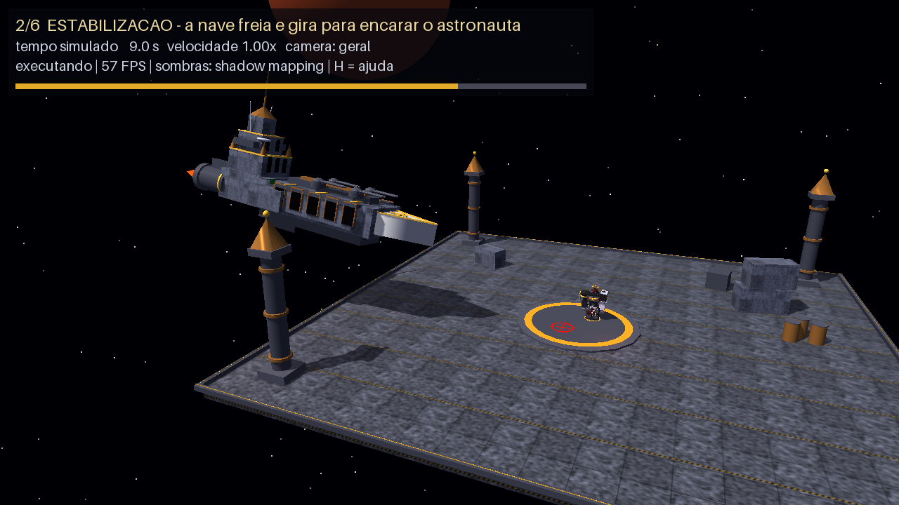

# Nave × Astronauta — Inspeção em uma plataforma gótica (estética Warhammer 40.000)

Trabalho Prático de **Computação Gráfica** — Ciência da Computação, UNIPAC, 2026/02.
Cena 3D animada em **Python + Pygame + PyOpenGL** sobre o framework do livro
*Developing Graphics Frameworks with Python and OpenGL* (Stemkoski & Pascale, 2022).



> **Leia primeiro:** a seção [Estado de validação](#estado-de-validação-o-que-foi-e-o-que-não-foi-testado).
> O projeto foi desenvolvido e testado num ambiente **sem Pygame e sem PyOpenGL instalados**
> (por isso a validação usou uma camada de teste própria sobre Mesa). **O grupo precisa rodar
> `python main.py` na sua máquina e cumprir a lista manual de `docs/PLANO_DE_TESTES.md` antes de apresentar.**

---

## 1. Integrantes e temas

| Integrante | Tema sorteado | Contribuição principal |
|---|---|---|
| `[PREENCHER: nome 1]` | `[PREENCHER: Nave espacial (tema 6) ou Astronauta estilizado (tema 19)]` | `[PREENCHER]` |
| `[PREENCHER: nome 2]` | `[PREENCHER: o outro tema]` | `[PREENCHER]` |

Temas da dupla (enunciado): **6 – Nave espacial** e **19 – Astronauta estilizado**. Quem recebeu cada
tema, os nomes e as contribuições individuais **não foram informados**: preencham os campos acima e a seção 12.

## 2. Descrição do cenário

Uma **plataforma de inspeção militar** (deck de 36 × 36 m com textura de painéis de aço) flutua no espaço
diante de um planeta avermelhado e de um campo de estrelas. No centro há um **pad circular** com anéis
dourados e duas marcas no chão: onde o astronauta começa (anel dourado) e a **marca de inspeção**
(anel vermelho com mira). Quatro **pilares góticos** nos cantos, contêineres e barris completam o ambiente
sem competir com os modelos. Uma luz direcional ("sol") projeta as sombras; os motores da nave e uma
luminária vermelha do pad tingem a cena.

## 3. Os dois modelos

Ambos são **compostos só por primitivas do framework** (caixa, esfera/elipsoide, cilindro, cone, prisma,
pirâmide e toro), com translação, rotação e escala por peça. As peças de uma mesma articulação e mesmo material
são fundidas (`Geometry.merge`) para reduzir chamadas de desenho; a hierarquia de animação fica nas articulações.

| | Astronauta (`astronaut.py`) | Nave (`spaceship.py`) |
|---|---|---|
| Primitivas | 125 → 44 malhas, 26 064 vértices | 120 → 16 malhas, 16 764 vértices |
| Hierarquia | 14 nós `Group`: raiz › corpo (escala 0,9) › quadris › joelhos; tronco › pescoço, ombros › cotovelos, ombreiras | raiz (pos + yaw/pitch/roll) › corpo (escala 0,9) › motores (chamas, disco), balizas, luz pontual |
| Referências | armadura preta/grafite, visor vermelho, coroa gótica, águia dourada com caveira, 4 bolsas, abdômen nervurado, cinto com corrente e caveiras, joelheira com caveira dourada × faixa vermelha, ombreira esquerda com inscrições, braço esquerdo prateado | casco cinza longo texturizado, proa em cunha clara com friso dourado, 10 alcovas em arco com molduras de bronze, 4 torres de artilharia, torre escalonada à ré com espigão e antenas, 2 propulsores com chama |
| Animação | caminhar (passada ligada à distância andada), girar corpo/cabeça, erguer o braço e acenar, respiração | voo curvo com inclinação nas curvas, giro para encarar o astronauta, hover, pulsos dos motores (chama, brilho e luz), balizas piscando, partida |

> Fidelidade às imagens de referência: reconhecível, porém **simplificada** (não há correntes soltas nem capa;
> a "capa" é um pedaço de pano rígido). É uma aproximação por blocos, não uma réplica.

## 4. A interação (máquina de estados — `animation.py`)

Cada transição depende do **progresso do estado atual**; a nave só parte depois que o braço do astronauta voltou ao repouso.

| # | Estado | Nave | Astronauta | Sai quando |
|---|---|---|---|---|
| 1 | `APROXIMACAO` (7,0 s) | voa por curva de Bézier, freando (ease-out), inclinando nas curvas | parado; a cabeça passa a acompanhar a nave ao se aproximar | fim do percurso |
| 2 | `ESTABILIZACAO` (2,6 s) | paira, gira ~92° (yaw) para encarar o pad, reduz motores | observa | giro concluído |
| 3 | `REACAO_DO_ASTRONAUTA` (5,4 s) | paira | gira o corpo, **caminha 2,9 m** até a marca e vira para a nave | chegou à marca |
| 4 | `SINALIZACAO` (3,8 s) | paira (motores constantes) | ergue o braço esquerdo e **acena 3 vezes** | 3 acenos completos |
| 5 | `RESPOSTA_DA_NAVE` (3,6 s) | **3 pulsos** dos motores, balizas piscando, leve cabeceio | mantém o braço no alto | pulsos concluídos |
| 6 | `RETOMADA` (7,5 s) | espera 1,0 s; **só depois que `armRaise == 0`** gira e parte acelerando | baixa o braço (1,0 s) e acompanha a nave com o olhar | nave sai de cena |
| 7 | `CONCLUIDO` | invisível | volta a olhar à frente | `R` reinicia (ou `--loop`) |

Duração total ≈ 29,9 s. Cada pose é uma **função pura de (estado, tempo no estado)**; o tempo avança por `dt`.

## 5. Tecnologias e dependências

Python 3.12 (única versão testada; deve funcionar em 3.9+, **não verificado**) · Pygame ≥ 2.5 · PyOpenGL ≥ 3.1.7 · NumPy ≥ 1.24 · Pillow (só para gerar texturas e nos testes gráficos).
Requer **OpenGL 3.3 (core)** / GLSL 330. Veja `requirements.txt`.

## 6. Estrutura de diretórios

```
main.py            janela, argumentos de linha de comando e loop (usa core/base.py)
app.py             monta a cena, avança a simulação, desenha (independente da janela)
animation.py       máquina de estados + poses por tempo decorrido (delta time)
astronaut.py       modelo e hierarquia do astronauta, applyPose()
spaceship.py       modelo e hierarquia da nave, motores, luz pontual, applyPose()
scene.py           ambiente: deck, pad, pilares, contêineres, planeta, estrelas
camera.py          câmera em perspectiva com controle orbital (teclado/mouse)
lighting.py        luzes, biblioteca de materiais, parâmetros do shadow mapping
modeling.py        PartBuilder: composição T·R·S de primitivas + junta + poseTransform
hud.py             textos 2D (câmera ortográfica) e miniatura do mapa de sombras
bootstrap.py       ajusta sys.path (framework/ no estilo de imports do livro)
framework/         framework do livro (core, geometry, material, light) + adaptações
shaders/           GLSL: lit.vert/frag (+ common_light/shadow.glsl), depth.*, basic.*, texture.*, depthview.frag
textures/          painel_metalico.png (piso), casco_cinza.png (nave)
tools/             gerar_texturas.py, gerar_capturas.py
tests/             test_logic.py, test_render_headless.py, mutation_shadow_bias.py, headless/ (camada de teste)
docs/              PLANO_DE_TESTES.md, ROTEIRO_E_PERGUNTAS.md, img/
```

## 7. Instalação e execução

```bash
python -m venv .venv
# Windows: .venv\Scripts\activate        Linux/macOS: source .venv/bin/activate
pip install -r requirements.txt
python main.py
```

| Opção | Efeito |
|---|---|
| `--loop` | reinicia a sequência sozinha |
| `--fps N` | limita a N FPS (0 = sem limite). **Use `--fps 15` e `--fps 120` para mostrar a independência da taxa de quadros** |
| `--size 1600x900` | tamanho da janela |
| `--shadow-res 4096` / `--pcf 2` | resolução do mapa de sombras / suavização das bordas (0 = sombra dura) |
| `--no-shadows` | desliga o shadow mapping (para comparar) |
| `--no-hud`, `--no-msaa` | sem HUD / sem antialiasing |
| `--gl-check` | liga a checagem de erros do PyOpenGL (mais lenta; use ao depurar) |

Para regenerar as texturas: `python tools/gerar_texturas.py`.

## 8. Controles

| Tecla / mouse | Ação |
|---|---|
| `←` `→` `↑` `↓` ou arrastar com o botão esquerdo | orbitar a câmera |
| `W` `S`, `+` `-` ou roda do mouse | aproximar / afastar |
| `A` `D` / `Q` `E` | deslocar o alvo lateralmente / subir e descer |
| `1` geral · `2` segue o astronauta · `3` segue a nave · `4` livre | modos de câmera |
| `ESPAÇO` | **pausar / retomar** a animação (a câmera continua respondendo) |
| `R` | **reiniciar** a sequência |
| `,` `.` | velocidade da simulação 0,25× … 4× |
| `G` | mostrar/ocultar o **mapa de sombras** (profundidade vista da luz) |
| `H` | mostrar/ocultar a ajuda na tela |
| `ESC` | sair |

Limites da câmera: elevação 4°–86°, distância 3–90 m, nunca abaixo do piso nem dentro da caixa da nave.
O estado e o FPS aparecem no HUD e no título da janela.

## 9. Conceitos gráficos e onde estão

### 9.1 Transformações e hierarquia
Cada peça usa `M = T · Ry · Rx · Rz · S` (`modeling.PartBuilder.add`): a escala age primeiro, a translação por último.
Cada articulação é um `Group`; a matriz local é **recomposta a cada quadro** a partir dos ângulos (`poseTransform`,
`Astronaut.applyPose`), sem acumular rotações (não há deriva). A matriz de mundo é `W = W_pai · T_local`
(`Object3D.getWorldMatrix`; o `Renderer` calcula todas de uma vez por quadro). Exemplo: ao erguer o braço, a mão herda
raiz › corpo › tronco › ombro › cotovelo; a ombreira (filha do tronco) acompanha só 35% do movimento.

### 9.2 Animação por tempo (delta time)
`stateTime += dt` (segundos), nunca "por quadro". O `Base` mede `dt` com `clock.tick()` e o limita a 0,05 s.
Se `dt` cruza o fim de um estado, a sobra vai para o seguinte. Pausar = `director.update(0)`.
**Provado por testes:** o resultado a 15, 30, 60, 144 e 240 FPS (e com `dt` irregular) é igual (tolerância 1e-6), inclusive a imagem final.

### 9.3 Câmera
Perspectiva (`Matrix.makePerspective`, 50°, near 0,1, far 1000). Posição esférica em torno do alvo; orientação por
`Matrix.makeLookAt`; `viewMatrix = inversa(matriz de mundo da câmera)`.

### 9.4 Iluminação e materiais (`lighting.py`, `shaders/common_light.glsl`)
4 luzes (limite do framework): **ambiente** (azulada, fraca), **direcional** (sol — única que projeta sombra),
**pontual dos motores** (filha da nave; sua cor é proporcional à potência do motor) e **pontual vermelha** do pad.
`PhongMaterial` = ambiente + difusa (`max(N·L,0)`) + especular (`specularStrength · max(R·V,0)^shininess`);
`LambertMaterial` = sem o especular. Metais (prata, ouro, bronze) têm brilho forte e estreito; couro, osso e pano são foscos.
As **normais** vêm da geometria (cada face da caixa, derivadas da superfície nas paramétricas) e, no vertex shader,
são transformadas pela **inversa transposta** de `mat3(modelMatrix)` (correto com escala não uniforme).
Elementos **emissivos** (visor, chamas, balizas, anéis do pad) usam `SurfaceMaterial` sem iluminação.

### 9.5 Texturas e UV
`textures/painel_metalico.png` (deck) e `textures/casco_cinza.png` (casco da nave), 512×512, repetíveis, carregadas por
`core/texture.py` (Pygame) e amostradas com `texture(baseTexture, UV)`. As UV da caixa vão de 0 a *(tamanho da face ÷ `uvTile`)*,
com `GL_REPEAT`: a textura repete a cada 4 m no deck (36 m → 9 repetições) sem esticar nas faces grandes.
**Origem:** geradas por `tools/gerar_texturas.py` (NumPy + Pillow, semente fixa) — **criação própria, sem imagens de terceiros**.

### 9.6 Sombra projetada × sombreamento
*Sombreamento* é o escurecimento de uma superfície voltada para longe da luz (`N·L ≤ 0`) — depende só da própria superfície.
*Sombra projetada* é quando **outro objeto** bloqueia a luz — exige comparar profundidades (shadow mapping, seção 6.9 do livro).

### 9.7 Shadow mapping (seção 6.9) — `Renderer`, `Shadow`, `DepthMaterial`, `lit.*`
1. **Configuração:** a luz direcional recebe uma *câmera da luz* **ortográfica** (filha dela) cobrindo ±23 m ao redor da ação
   (`lighting.SHADOW`). 2048² texels → ≈ 2,2 cm por texel.
2. **Passe 1 (mapa de profundidade)** — `Renderer._shadowPass`: renderiza todas as malhas vistas da luz com `DepthMaterial`
   (`depth.vert/frag`), gravando `gl_FragCoord.z` numa textura **R32F** (framebuffer da `RenderTarget`); fundo branco = profundidade 1.
3. **Passe 2 (cena)** — `lit.vert` calcula `shadowPosition0 = P_luz · V_luz · M · v`; `lit.frag` converte para [0,1]
   (`·0,5 + 0,5`) e compara `coord.z` com a profundidade guardada: se for maior (+ viés), o fragmento está na sombra.
4. **Aplicação:** a sombra reduz só a luz **direta direcional** (difusa + especular) por `strength = 0,72`; ambiente e luzes
   pontuais não são afetadas. Bordas suavizadas por **PCF** 3×3.
5. **Atualização:** o passe 1 roda **todo quadro**, então a sombra acompanha o astronauta e a nave.
6. **Acne e viés:** `bias = 0,0004` (mínimo) + `slopeBias = 0,0025 · (1 − N·L)` (cresce em superfícies rasantes). Valores
   medidos nos testes (seção 11): metade deles já produz acne; viés ≥ 0,02 já descola a sombra do objeto.
7. **Fora do volume da luz** não há sombra (cor de borda branca / teste explícito no shader).

### 9.8 Shaders, atributos e uniforms

| Atributo (`layout location`) | Tipo | Uso |
|---|---|---|
| `vertexPosition` (0) | vec3 | todos os shaders |
| `vertexColor` (1) | vec3 | `basic` (estrelas) |
| `vertexUV` (2) | vec2 | `lit`, `texture` |
| `vertexNormal` (3) | vec3 | `lit` (`faceNormal`, 4, existe na geometria mas não é usado) |

| Uniform | Tipo | Quem |
|---|---|---|
| `modelMatrix` / `viewMatrix` / `projectionMatrix` | mat4 | todos (modelo: por objeto; view/proj: por quadro) |
| `baseColor`, `useVertexColors`, `useTexture`, `baseTexture` (unid. 1), `repeatUV`, `offsetUV` | vec3/bool/sampler2D/vec2 | material |
| `light0…light3` | struct `Light` (tipo, cor, direção, posição, atenuação; **em coordenadas de mundo**) | `lit.frag` |
| `viewPosition`, `specularStrength`, `shininess` | vec3, float | Phong |
| `useShadow`, `shadow0` | bool, struct `Shadow` (direção, `projectionMatrix`, `viewMatrix`, `depthTexture` (unid. 15), `strength`, `bias`, `slopeBias`, `pcf`) | `lit.*` |

Comunicação Python → GPU: `Attribute` (VBO + `glVertexAttribPointer`, guardado no VAO de cada `Mesh`) e `Uniform` (`glUniform*`).
`glUniformMatrix4fv(..., GL_TRUE, ...)` transpõe, porque o NumPy guarda por linhas e o GLSL espera colunas.

## 10. Requisitos do enunciado × onde estão

| # | Requisito (PDF) | Implementação |
|---|---|---|
| 1 | Dois temas em 3D num ambiente | `astronaut.py::Astronaut`, `spaceship.py::Spaceship`, `scene.py::Environment` |
| 2 | Animação, interação, controlada pelo tempo | `animation.py::InteractionDirector.update` (+ `State`), `core/base.py` (`deltaTime`), `app.py::Application.update` |
| 3 | Translação, rotação, escala, hierarquia | `modeling.py::PartBuilder.add`, `joint`, `poseTransform`; `Astronaut.applyPose`; `Spaceship.applyPose`; `core/object3D.py`; `core/matrix.py` |
| 4 | Câmera em perspectiva, teclado, pausa sem interromper a visualização | `camera.py::OrbitCamera`; `core/matrix.py::makePerspective/makeLookAt`; `app.py` (`paused`, `simDt`) |
| 5 | Textura de imagem com UV adequadas | `textures/*.png`; `core/texture.py`; `geometry/boxGeometry.py` (`uvTile`); `shaders/lit.frag`; usada em `scene.py` (deck) e `spaceship.py` (casco) |
| 6 | Luz direcional, materiais, normais | `lighting.py`; `shaders/common_light.glsl`, `lit.vert/frag`; `geometry/parametricGeometry.py` (normais); `material/litMaterial.py` |
| 7 | Sombra projetada por shadow mapping (6.9), atualizada no movimento | `core/renderer.py::_shadowPass`, `light/shadow.py`, `material/depthMaterial.py`, `core/renderTarget.py`, `core/texture.py::allocateFloat`, `shaders/depth.*`, `shaders/lit.*` |
| — | Explicar shaders, atributos e uniforms | seção 9.8 |
| — | Distinguir sombreamento de sombra projetada | seção 9.6 |
| — | Bônus (até 10%) | **Não implementado.** Não há pós-processamento, bump mapping, bloom nem texturas procedurais em tempo de execução (as texturas são PNGs gerados *offline* e carregados normalmente). O PCF e a miniatura do mapa de sombras (`G`) são complementos técnicos; não os apresentem como bônus sem confirmar com o professor. |

## 11. Estado de validação (o que foi e o que não foi testado)

**Ambiente da validação:** Linux, Python 3.12.3, NumPy 2.4.4, contexto **OpenGL 4.5 core da Mesa (llvmpipe, rasterizador por
software)** acessado por uma camada de teste própria em `ctypes` (`tests/headless/`) que imita o subconjunto usado de
PyOpenGL/Pygame. **Não havia Pygame, PyOpenGL, GPU nem janela.**

| Item | Situação |
|---|---|
| Compilação/ligação de **todos os shaders** (GLSL 330 core, compilador estrito da Mesa) | ✔ validado |
| Geometrias: sem NaN, normais unitárias, faces para fora (volume > 0 e ≈ valor analítico) | ✔ validado |
| 35 testes de lógica (matrizes, estados, delta time, pausa, câmera, fontes) | ✔ passam |
| 21 testes gráficos com render real (textura, sombras, acne, direção da luz, pausa, FPS) | ✔ passam (na camada de teste) |
| Inspeção visual de quadros de todos os estados | ✔ feita pelo desenvolvedor (IA); ver `docs/img/` |
| Custo de CPU: 4,4 ms por `update()` (70 malhas; 128 chamadas de desenho/quadro com sombra) | ✔ medido (sem GPU: FPS real **não medido**) |
| **Execução com Pygame e PyOpenGL reais, janela, teclado e mouse** | ✘ **não executado** |
| **GPUs/drivers reais (NVIDIA, AMD, Intel, Apple), Windows, macOS** | ✘ **não executado** |
| Antialiasing (MSAA) e criação da janela por `Base` | ✘ não executado |
| HUD com as fontes reais do Pygame (a medição do texto é feita em tempo de execução) | ✘ não executado |
| Compatibilidade PyOpenGL × NumPy 2.x na máquina do grupo | ✘ não verificado (se der erro de arrays, atualize o PyOpenGL ou use `numpy<2`) |

**Sensibilidade dos testes de sombra** (`tests/mutation_shadow_bias.py`): sem viés → acne detectado; com a metade dos valores
atuais → acne detectado (folga de ~2×); viés 0,02 ou 0,03 → "sombra flutuando" detectada; **viés 0,01 NÃO é detectado** por esse teste.

**Limitações conhecidas:** só a luz direcional projeta sombra (o framework tem 4 luzes e uma `Shadow`); sombras só dentro de
±23 m da ação; a nave sai do volume de sombra ao longe (sem sombra lá); a câmera usa uma caixa (OBB) da nave, não malha;
a fidelidade às referências é simplificada.

## 12. Divisão das contribuições individuais

`[PREENCHER pelo grupo]` — descrevam, por integrante, o que fez (modelagem do astronauta / da nave, animação, câmera,
iluminação e sombras, texturas, documentação, testes) e **o que revisou e alterou** após receber o código da IA.

## 13. Fontes e créditos

* STEMKOSKI, Lee; PASCALE, Michael. *Developing Graphics Frameworks with Python and OpenGL*. Boca Raton: CRC Press, 2022.
  DOI 10.1201/9781003181378. O código de `framework/` é **adaptado das listagens do livro** (capítulos 2–6; ver cabeçalho de
  cada arquivo). A versão aberta do livro é licenciada **CC BY-NC-ND 4.0**; o enunciado permite adaptar os exemplos desde que
  identificados. Uso estritamente acadêmico — **não publiquem o código como obra própria sem checar a licença/o repositório oficial**.
* Texturas: criação própria (`tools/gerar_texturas.py`).
* Imagens de referência (4, fornecidas pelo grupo, **não incluídas** no projeto): guia visual de proporções, cores e silhuetas.
  `[PREENCHER: origem/autoria de cada imagem]` (a primeira exibe a assinatura "SHIMHAQ").
* *Warhammer 40.000* é marca da Games Workshop; este trabalho é acadêmico, sem fins comerciais e sem afiliação.

## 14. Declaração de uso de inteligência artificial

* **Ferramenta:** Claude (Anthropic), modelo Claude Sonnet 5.5, em conversa de chat.
* **Finalidade e trechos:** a IA **escreveu todos os módulos** do projeto (`main.py`, `app.py`, `animation.py`, `astronaut.py`,
  `spaceship.py`, `scene.py`, `camera.py`, `lighting.py`, `modeling.py`, `hud.py`, shaders, scripts em `tools/` e `tests/`) e
  **reescreveu o framework** a partir da leitura das listagens do livro (PDF fornecido), registrando as divergências abaixo;
  também redigiu esta documentação, o plano de testes e o roteiro.
* **Validação feita pela IA:** os testes automatizados e as inspeções visuais da seção 11, na camada de teste descrita.
* **Revisão e alterações do grupo:** `[PREENCHER: o que o grupo leu, testou na própria máquina, modificou e entendeu]`.
  Este texto **não afirma** que o grupo escreveu manualmente qualquer parte do código.

### Divergências deliberadas em relação ao livro (para explicar na apresentação)

| Livro | Aqui | Motivo |
|---|---|---|
| `Object3D.setPosition` usa `ndarray.itemset` | indexação direta | `itemset` foi removido no NumPy 2.0 |
| shader `texture2D(texture, UV)` e uniform `texture` | `texture(baseTexture, UV)` | `texture2D` não existe em GLSL 330 core; `texture` colide com a função embutida |
| mapa de sombras em RGBA8 (256 níveis) + `bias 0,01` | textura **R32F** + `bias 0,0004` + `slopeBias` + PCF | precisão; menos acne e menos "sombra flutuando" |
| `glClearColor(1,1,1,1)` no passe de sombra, nunca restaurada | restaurada após o passe | o fundo ficaria branco |
| localização dos atributos dependia do linker (VAO × `DepthMaterial`) | `layout(location=N)` fixo em todos os shaders | o mesmo VAO precisa servir a dois programas |
| `calcNormal` divide por zero nos polos/ápice | normal reavaliada para dentro + valores de reserva | evita NaN |
| `applyMatrix` transforma normais só com a rotação | inversa transposta | escala não uniforme |
| luzes enviadas em coordenadas locais | coordenadas de mundo | luz filha da nave |
| um programa GLSL por material; matrizes de mundo recalculadas por recursão | cache de programas; cache de matrizes; agrupamento por material | desempenho (menos chamadas GL) |
| `makeScale(s)` uniforme | também `makeScale(sx,sy,sz)` | escala por eixo |
| — | `BoxGeometry(uvTile)`, `TorusGeometry`, `Geometry.merge` vetorizado, `Texture.allocateFloat`, `Mesh.castShadow` | extensões deste projeto |
